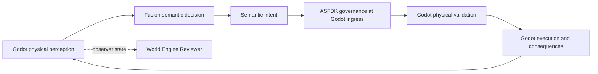

# AI-Fusion Architecture

**Repository:** `NeuroLift-Technologies/nlt-ai-fusion`  
**Status:** Current architecture baseline  
**Last updated:** 2026-10-30  
**Governance:** ORG-DEV-OTOI-1.0.3

## 1. Scope and system boundary

`nlt-ai-fusion` implements the cognitive and learning layer of the NeuroLift embodied-AI research platform. It does not own or simulate physical reality.

| System | Authority and responsibility |
|---|---|
| `nlt-world-engine` | Authoritative physical world: Godot 4.7.2, world state, space, time, physics, embodied agents, objects, affordances, movement, and physical consequences |
| `nlt-ai-fusion` | Cognitive intelligence: Avatar traits, Aide expertise, semantic decision-making, session orchestration, model adapters, learning evaluation, and Avatar–Aide fusion |
| World Engine Reviewer | Human-facing representation and observer of Godot world state. It is not a second simulation or an AI decision-maker |
| `nlt-adhd` | User-facing runtime and personalized Advocate delivery |

The governing separation is **Godot owns physical reality; Fusion owns cognitive intelligence**. The Reviewer observes the physical simulation. Fusion does not interact with the Reviewer.

## 2. Avatar–Aide–Advocate model

The cognitive architecture has two source systems and one resulting capability:

1. **Avatar:** develops experiential understanding through its own embodied challenges, decisions, outcomes, and learning history.
2. **Aide:** contributes domain expertise, coaching strategies, feedback, and intervention evaluation.
3. **Advocate:** the result of fusing the trained Avatar and Aide capabilities after readiness criteria are met.

The Advocate is not a third independent model inserted between Avatar and Aide. It is the product of their training and fusion.

| Area | Repository path | Responsibility |
|---|---|---|
| Avatar foundations and trait implementations | `src/avatars/` | Trait-specific state, struggle, task attempts, and experience |
| Aide foundations and expertise | `src/aides/` | Coaching, strategies, intervention outcomes, and expertise |
| Advocate foundations | `src/advocates/` | Combined empathic support and expert guidance |
| Fusion and readiness | `src/fusion/` | Readiness assessment, fusion results, and semantic decision-making |
| Session orchestration | `src/simulation/session_orchestrator.py` | Avatar–Aide observe/coach/retry and session-level metrics |
| Scenario catalogue | `src/simulation/scenario_catalog.py` | Cognitive/task scenario definitions |
| Scenario structure | `src/simulation/scenarios/` | Multi-step scenario abstractions |

## 3. Physical-world agent loop

The cross-repository control contract is `nlt.agent-loop.v1`.

- Godot sends an agent-specific physical snapshot: self state, scene, visible entities, and affordances.
- Fusion validates the envelope and obtains a semantic decision.
- Fusion returns constrained intents such as `approach`, `look_at`, `use`, `sit`, `rest`, `communicate`, or `wait`.
- Fusion does not issue coordinates, velocity, teleportation, physics commands, or direct object-state writes.
- Godot applies ASFDK-C# governance at intent ingress and independently validates current physical conditions before execution.
- The resulting physical state is used for the next perception.

### Fusion implementation

- `src/fusion/agent_loop.py`: transport-neutral perception and intent validation seam.
- `src/fusion/agent_loop_http.py`: local HTTP adapter at `POST /agent-loop/perception`.
- `docs/agent-loop-model-adapter.md`: decision-source configuration and bounded inference behavior.
- `docs/specs/AGENT-LOOP-003-fusion-state-and-goals-brief.md`: state, goals, memory, and ranking behavior.

The currently documented Godot integration is an **opt-in local loopback test path**, not a production remote endpoint. Request/response and correlated intent behavior have been exercised, but headless preflight or HTTP 200 alone does not prove accepted physical movement, arrival, or persistent learning. Use the interactive Godot test to validate physical consequences.

The `nlt.state-feed.v1` observer feed is separate from the control protocol. The Reviewer represents world state; it does not carry Fusion decisions.

## 4. Cognitive session and learning lifecycle

The Python `SessionOrchestrator` currently provides a task/scenario-level Avatar–Aide cycle:

1. Pair an Avatar with an Aide.
2. Avatar attempts a task.
3. Aide observes struggle and may provide coaching.
4. Avatar retries and the Aide records intervention effectiveness.
5. Session metrics and independence/readiness are evaluated.
6. `FusionEngine` can produce a fusion report/result when readiness criteria are met.

**Important integration boundary:** `SessionOrchestrator` is not currently wired to consume Godot agent-loop perceptions or to make embodied Godot experience automatically update persistent Avatar model weights. The local agent-loop and task-level session orchestrator are distinct paths. Closing that gap is a primary engineering milestone.

Do not describe inference as training. A model choosing an intent is inference. Demonstrating learning requires a reproducible change in behavior or capability attributable to experience/coaching, persistence of that change, and evaluation against baselines and held-out scenarios.

## 5. Model execution

The agent-loop supports a deterministic baseline and optional model-backed decision sources, including GGUF and Transformers adapters. Configuration is environment-driven:

- `FUSION_AGENT_LOOP_MODEL`
- `FUSION_GGUF_MODEL`
- `FUSION_TRANSFORMERS_MODEL`
- `FUSION_AGENT_LOOP_TIMEOUT`

The deterministic baseline is a control/reference implementation, not a trained Avatar. Model selection, batching, GPU requirements, and concurrency must be justified with measured latency, memory, task success, and learning outcomes. Do not assume one model copy per simulated agent.

## 6. Persistence and application surfaces

The repository contains FastAPI, Next.js, Expo, and Supabase-related application components. Their presence does not establish that Godot simulation state, Avatar experience, Aide interventions, and Advocate fusion are already connected through a complete durable learning pipeline.

The active Godot physical state remains authoritative in `nlt-world-engine`. Persistence contracts for learned cognitive state and experiment artifacts must be explicitly defined and tested at the Fusion boundary.

## 7. Retired implementations

The following competing or superseded implementations have been moved to `archive/legacy-world-engine/`:

- Python ECS/grid WorldEngine under the former `src/simulation/environment/`.
- Python WorldEngine REST router and its world-state schemas.
- Cloudflare Durable Object ECS simulation, Wrangler configuration, and WebSocket client.
- Three.js client for the former Cloudflare Worker.
- Standalone browser-based React simulation prototype and its schema.
- Old grid-world/training-session demo scripts and the broken legacy `TrainingSession` path.
- Tests that exclusively exercised the retired physical simulation.

These files are preserved for historical reference and are not supported runtime entrypoints. Do not import them into active code or restore a second physical source of truth. The reusable cognitive scenario catalogue remains active at `src/simulation/scenario_catalog.py`.

## 8. Security and governance boundaries

- Godot is authoritative for physical state and consequences.
- ASFDK-C# enforces governance at the physical intent ingress. Fusion's Python endpoint does not replace that gate.
- Validate agent identity, message correlation, observed tick freshness, visible targets, and supported intent verbs.
- Remote transport must add authenticated service identity, request integrity, replay protection, bounded timeouts, and explicit failure behavior before public deployment.
- Never place credentials in repository files or expose local loopback endpoints publicly without an approved security design.
- Human authority and OTOI governance remain in force for architecture, provider, persistence, and deployment decisions.

## 9. Next engineering milestones

1. Establish a secure remote transport while preserving `nlt.agent-loop.v1`.
2. Connect Godot experience and physical outcomes to Avatar experience memory and Aide coaching records.
3. Define what changes in the Avatar after coaching and how those changes persist.
4. Define Advocate readiness and validate fusion against both source systems.
5. Run reproducible baseline, model, multi-agent, coaching, retention, and transfer experiments.
